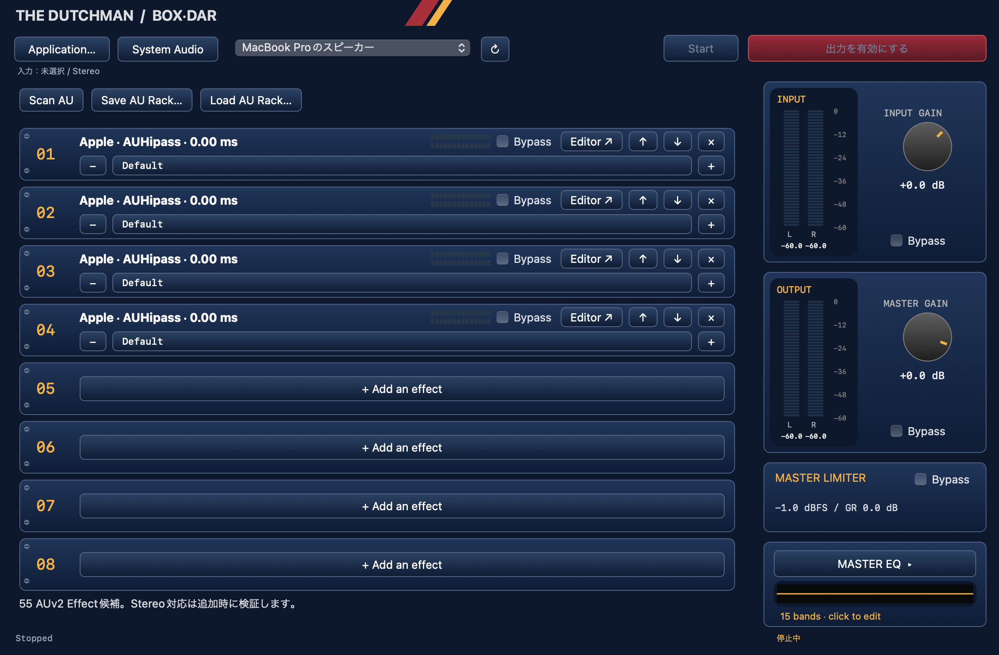

# 0.0.20 — App icon

BOXのラックをモチーフにしたmacOSアイコンを追加しました。原画はassets/AppIcon-source.png、生成プロンプトはassets/AppIcon-generation.json、配布リソースはResources/AppIcon.icnsです。通常ビルド時に必要なら再生成します。Audio EngineはAuto / ASRC既定のままです。

---

# 0.0.19 — Auto / ASRC default

AudioFuse実機でのユーザー確認を受け、新Clock / Rate Adapterを起動時の既定にしました。現在のProcess Tap / Aggregate経路は同期未証明なのでASRCを選択します。同一レートだけを根拠にDirectへ移行しません。SRC係数・品質・AU/DSP処理は0.0.18から変更なし。

アプリメニューのLegacy Linearにチェックすると次のStartから従来方式へ戻せます。起動直後はチェックなし（Auto）。実際の稼働モードはAudio Engine DiagnosticsのModeで確認してください。切替は次のStartに適用され、再起動時はAutoに戻ります。

提供された診断画像では48kHz/512 frames、57,768 callback、underrun/overrun/recoveryとも0、平均2.379ms、最大4.103ms。callback期間約10.667msに収まっています。これは当該実機・ラックでの観測であり、全プラグイン・全機器・長期間の保証ではありません。AppleとのオフラインCPU差は引き続き改善検討事項です。

以下の0.0.18以前の説明は履歴です。現行設定は本節を参照してください。

---

# 0.0.18 — Engine menu fix

起動時に古いQuit専用メニューで上書きしていた問題を修正。アプリメニューからAudio Engine DiagnosticsとLegacy Linear選択が利用できます。Legacy既定です。

---

# 0.0.17 — Gain wheel control

Input Gain / Master Gainはノブ上のマウスホイールで調整できます。Shiftで微調整。トラックパッドにも対応し、慣性スクロールによる変更は抑止します。Audio Engineは0.0.16候補版と同じLegacy既定です。

---

# 0.0.16 — Phase 1 candidate / measured, not promoted

Clock / Rate Adapterと開発用診断・3方式SRC比較ハーネスを追加しました。**自前sincはApple Mastering/Maxより約5倍遅いため、Legacyを既定として保持しています。** アプリメニューのLegacy Linearを外すと、次のStartから新Adapterを明示的に試せます。現在のTap Aggregateのクロック同期は未証明なので、その場合は保守的にASRCを選択します。Directの実機自動選択を保証する版ではありません。

[実測・採用判断・未検証項目](docs/engine-phase1/REPORT.md)。AU Host / GEQ / Crossfeed / Limiterは変更していません。AudioFuse実機での長時間試験は未確認です。

診断はアプリメニュー「Audio Engine Diagnostics…」またはCmd-Option-D。比較WAV・CSVの生成はオフラインテスト側だけです。

---

# The Dutchman BOX/DAR

# 0.0.15 — Gainコントロールの整理

Input Gain / Master GainのBypassを削除し、ノブの値を常に適用します。

---

# 0.0.14 — System Audioの多チャンネル減衰対策

System Audioの取り込みを、グローバルなステレオミックスダウンから、macOS通常出力デバイスの先頭ストリーム・ch 1/2を直接取り込む非ミックスダウンTapへ変更しました。多チャンネル機器で未使用チャンネルも含めたミックスダウンにより音量が下がる経路を避けます。固定ゲイン補正は入れていません。

- macOSの通常出力を音源の出力先（例：AudioFuse）に合わせてください。アプリの出力先は従来どおり別途選択できます。
- 取り込むのは通常出力デバイスの先頭ストリームのch 1/2です。他のデバイスやch 3以降は合算しません。
- 通常出力先の変更時は停止し、Startで新しい取り込み先に接続します。元音声ミュートと自アプリ除外は維持します。
- 2/4/8/16chのインターリーブ入力と8chの分離入力から、先頭ステレオペアをサンプル値を変えずに取り込むテストを通過。AudioFuse実機でStart時の音量低下の改善をユーザー確認済みです。

```sh
bash scripts/test-tap-input.sh
```

更新前にInput Gainで増幅していた場合は、**0 dBへ戻してから**比較してください。

---

# 0.0.13 — Spatial Listening / Crossfeed

右下のSPATIALボタンからGEQ同様のフローティングパネルをワンクリックで開きます。「Crossfeed 有効」をオンにするとヘッドホン向けの左右間処理が動作します。初期状態はOFFです。閉じても処理と設定は維持されます。

- L/Rスピーカーをドラッグ：左右対称のスピーカー角度（±10〜75°）と距離（0.4〜3 m）。
- 中央のYOUリングを上下ドラッグ：Crossfeed Amount（0〜100%）。上へ動かすと強くなります。
- ダブルクリック／Reset Field：±30°、1.5 m、Amount 50%へリセット。有効／無効の状態は維持します。

スライダーを使わず、透視投影した音場グリッド上で操作します。スピーカーと耳の距離差から遅延を計算し、低域中心の反対側への送りと左右混合を行います。距離・角度はCrossfeed近似モデルの入力であり、実際の部屋の距離感や前方定位を保証するものではありません。

**この版はCrossfeedです。HRTFのVirtual Speakersモードはまだ未実装です。** ステレオを左右の独立モノ音源としてHRTF処理する段階は後続です。

音声経路：Input Gain → AU Rack → **Crossfeed** → Master GEQ → Master Gain → Limiter。

パラメータはatomicで受け渡し、20 ms程度の平滑化を適用。遅延バッファは事前確保した固定容量です。設定はパネル開閉・Start/Stopで維持しますが、アプリ再起動後の復元とAU Rackファイルへの保存はまだ含みません。

検証：44.1/48/96/192 kHzでOffの透明性、対耳への遅延、低域寄りの特性、モノ/DCレベル維持、急なパラメータ変更時の有限・有界出力を確認。音声エンジンでAU出力後に作用すること、GUIのドラッグ→角度・距離・Amount変換、リセット、サブウィンドウの開閉もテストしています。

```sh
bash scripts/test-spatial.sh
bash scripts/test-spatial-ui.sh
```

ヘッドホンを使って音楽での聴感を確認してください。スピーカー出力では通常OFFを想定しています。

---

macOSで再生している音を、好きなAudio Unitへ通して聴くためのスタンドアロンAudio Rackです。



## 現在のバージョン

**0.0.20** — Apple Silicon / macOS 14以降。元音声をミュートするSystem AudioモードはmacOS 14.2以降。

- System AudioをCore Audio Process Tapで取得。取得中は元音声をミュートし、自アプリの出力は除外。
- アプリ単位の取得はScreenCaptureKitの標準ピッカーを使用。
- AUv2 Stereo Effectを最大8個追加。再生中の追加・削除・並べ替えに対応。
- メーカーの純正GUIをフローティング表示。純正GUIがない場合はAUGenericViewへフォールバック。
- Factory Preset、インストール済み`.aupreset`、ファイル指定による読み込み。
- 現在のプリセット表示、チェックマーク、編集状態、−／＋によるザッピング。
- Input Gain、15バンドMaster GEQ、Master Gain、左右連動Limiter、Emergency Mute。
- AU Rackの種類・順序・プラグイン状態・プリセット情報を保存・復元。

音声経路：

```text
Capture → SRC → Input Gain → AU Rack → Crossfeed → Master GEQ → Master Gain → Limiter → Mute → Core Audio Output
```

## ビルド

Apple SiliconのMacとXcode Command Line Toolsが必要です。外部SDKやライブラリは不要です。

```sh
bash scripts/build.sh
open 'build/The Dutchman BOX-DAR.app'
```

生成されるアプリは開発用のad-hoc署名です。App Store配布用・公証済みのアプリではありません。

CMake 3.24以降がある場合：

```sh
cmake -S . -B build-cmake -DCMAKE_BUILD_TYPE=Release
cmake --build build-cmake
ctest --test-dir build-cmake --output-on-failure
```

CMakeでは`build-cmake/DesktopAudioRack.app`が生成されます。CMake経由のビルドは未検証です。

## 使い方

1. System Audioを選び、出力デバイスを指定してStart。
2. 初回はmacOSの音声収録権限を許可。
3. 起動直後だけ出力がミュートされているため「出力を有効にする」を押す。以後は手動のミュート状態を維持。
4. 空きスロットの「Add an effect」からメーカー別AUメニューを開いて選択。
5. EditorでプラグインGUIを表示。Input GainでAUへ送るレベルを調整。
6. プリセット名をクリックして選択、−／＋で前後へ切替。編集したプリセットは斜体＋`*`で表示。
7. 右下のMASTER EQから15バンドGEQを開く。閉じても処理・設定は維持。
8. StopでSystem Audioの取得を終了し、元音声の通常再生へ戻る。

ノブとEQフェーダーはドラッグで操作、Shiftで微調整、ダブルクリックで0 dB。EQはFlatで全バンドを戻せます。

INPUTメーターはInput Gainの前、各スロットのメーターはそのAUの後、OUTPUTはミュートを含む最終出力です。

## 現時点の制限

- AUv2 Stereo Effect・単一入出力バスのみ。AUv3、VST3、Instrument、MIDI、サイドチェインは未対応。
- アプリ単位のScreenCaptureKit取得では元音声をミュートしないため、二重再生しない経路が必要。
- 第三者AUはin-processで実行。プラグイン自体のクラッシュを隔離する機能は未実装。
- Rack変更・プリセット適用時は出力を短く休止する。キャプチャと元音声のミュートは継続。
- SRCは検証用の線形補間。高品質SRCへの置換と長時間の安定性確認は後続課題。
- Limiterは−1 dBFSのサンプルピーク方式。true-peak保証・lookaheadはなし。
- 編集判定はAU公開の読み書き可能パラメータが対象。独自の非公開状態は検出できない場合がある。
- 保存対象はAU Rack。内蔵Gain / GEQ・デバイス設定はまだ保存しない。
- 出力はチャンネル1/2。デバイスのレートとバッファサイズは読み取りのみ。
- CrossfeedはSpatialパネルから使用可能。HRTFによる仮想スピーカーは未実装。

## テスト

```sh
bash scripts/test.sh
bash scripts/test-au.sh
bash scripts/test-au-ui.sh
bash scripts/test-controls.sh
bash scripts/test-drawing.sh
bash scripts/test-preset-browser.sh
bash scripts/test-main-ui.sh
bash scripts/test-effect-menu.sh
```

各スクリプトはASan/UBSan付きで実行します。AU・GUIのテストにはAudio Componentサービスに接続できるmacOSのログインセッションが必要です。音声キャプチャの権限と実音声の動作は実機で確認してください。

実機でMcDSP等のAU動作・元音声のミュート・プリセット読込を確認済み。自動テストはApple標準AUとテスト用プロセッサを中心に検証しています。

## 構成

- `src/AudioBridge.hpp` — 固定容量SPSCバッファ、SRC、処理順序
- `src/ProcessTap.*` — System Audioの取得・元音声ミュート
- `src/Output.*` — Core Audio HAL出力
- `src/plugins/` — AUホスト、GUI、プリセット、Rack保存復元
- `src/DSP.hpp` — Gain、15バンドGEQ、Limiter
- `src/Main.mm` / `Theme.*` / `RackControls.*` / `MeterView.*` — AppKit UI

変更履歴は[CHANGELOG.md](CHANGELOG.md)、開発中の詳細メモは[docs/DEVELOPMENT_HISTORY.md](docs/DEVELOPMENT_HISTORY.md)を参照してください。

メーカー製プラグイン・プリセット・商標の権利は各権利者に帰属します。このリポジトリには第三者プラグインやメーカーのプリセットデータを含めません。
